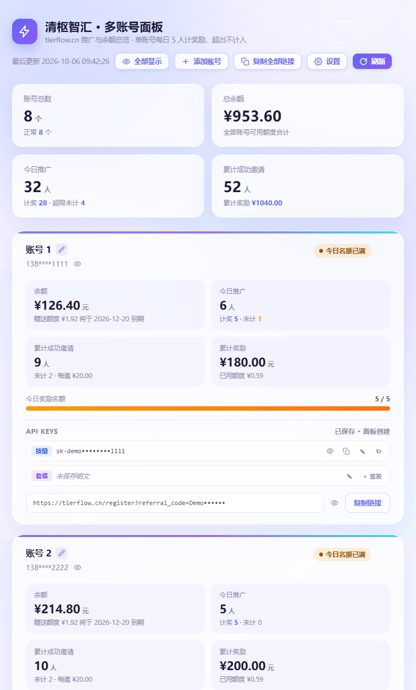

# 清枢智汇（TierFlow）多账号管理面板

> Skybaby 制作

聚合展示 [tierflow.cn](https://tierflow.cn) 多个账号的推广数据、余额与 API Key 的本地网页工具。

**零依赖**（只需 Node.js），**纯本地运行**（数据只存在你自己电脑上，不上传任何服务器）。

## 功能

- **总览**：账号数、总余额、今日推广（计奖 / 超限未计）、累计成功邀请与奖励
- **单账号卡片**：余额、今日推广、累计邀请、累计奖励、每日名额进度条（5/天）
- **API Key 管理**：按量 Key + 套餐 Key，支持显示/隐藏、复制、手动编辑、从平台新建/签发
- **推广链接**：一键复制单个 / 全部账号的注册推广链接
- **隐私打码**：手机号、Key、链接默认打码；点小眼睛单独切换，或顶部「全部显示/全部隐藏」
- **访问开关**：面板内「设置」可一键开启/关闭访问密码，并设置自己的用户名密码（即时生效，无需重启）
- 自动刷新（默认 5 分钟一次），也可手动刷新

## 环境要求

- **Node.js ≥ 14**（推荐 18 LTS 以上）
- 无需 npm install、无需数据库、无需注册任何在线服务

## 快速开始

### 1. 安装 Node.js（只需一次）

打开 <https://nodejs.org/zh-cn>，下载 **LTS 版本**，一路「下一步」装完即可。

### 2. 启动

| 方式 | 说明 |
|---|---|
| 双击 `start-silent.vbs` | **推荐**：后台启动，自动打开浏览器，没有黑窗口 |
| 双击 `start.bat` | 带控制台窗口启动（方便看报错），关掉窗口即停止 |
| 命令行 | `node server.js` |

启动后浏览器会自动打开 <http://localhost:8899>。如果没自动打开，手动输入这个地址即可。

### 3. 添加账号

点右上角 **「添加账号」**，输入手机号 + 密码（就是你在 tierflow.cn 登录用的那套）。
系统会**先真实登录验证一遍**，通过了才会加进列表。

## 访问密码（可选）

默认免密，本机/局域网直接用。若要把面板暴露到公网（套隧道、端口映射等），
点面板右上角 **「设置」** → 勾选「开启访问密码」→ 填用户名和密码 → 保存。

- 开启后：**本机仍免密**；其他设备打开需输入用户名密码（密码错 3 次会临时封 IP）
- 改动**即时生效**，不用重启；关掉开关即恢复免密
- 忘记密码：编辑 `accounts.json`，把 `"requireAuth": true` 改成 `false`，重启即可

> 安全说明：未开启密码时，面板仍可被同局域网设备访问，但「修改设置」只允许本机操作，
> 防止同网络的人远程改密码把你锁在外面。

## 常见问题

**Q：端口被占用（报 EADDRINUSE）？**
编辑 `accounts.json`，把 `"port": 8899` 改成别的数字（如 `8900`），重新启动。

**Q：想改刷新频率？**
编辑 `accounts.json` 的 `"refreshIntervalMs"`（单位毫秒，300000 = 5 分钟）。

**Q：数据会上传吗？会泄露吗？**
不会。程序完全在本机运行，账号、密码、Key 都只保存在本机的 `accounts.json` / `keys.json` 里，
不发送给任何第三方（只和 tierflow.cn 官方接口通信）。

**Q：搞不定怎么办？**
把整个文件夹发给你平时用的 AI 助手（豆包 / DeepSeek / Kimi / ChatGPT / Claude 等），说：
「请阅读文件夹里的《AI助手部署指南.md》，帮我在电脑上把它跑起来，缺什么教我补什么。」
也可以双击 `环境自检.bat` 一键体检，把输出发给 AI。

## 文件说明

| 文件 | 用途 |
|---|---|
| `server.js` | 后端服务（登录、拉数据、聚合） |
| `public/index.html` | 前端页面 |
| `accounts.example.json` | 配置模板（首次运行会自动生成 `accounts.json`） |
| `accounts.json` | 账号配置（**含密码，别发给别人**） |
| `sessions.json` | 自动生成的登录缓存（30 天有效） |
| `keys.json` | 完整 API Key 存储（自动生成） |
| `start-silent.vbs` | 静默启动（推荐） |
| `start.bat` | 带窗口启动（调试用） |
| `停止服务.bat` | 关闭面板服务 |
| `环境自检.bat` | 一键体检（Node / 文件 / 端口） |
| `AI助手部署指南.md` | 遇到问题就把它发给 AI 助手 |

## Key 说明（重要）

平台对已创建的 Key **只存哈希，不存明文**，列表接口返回的永远是打码值，
**无法从 API 还原完整 Key**。

**唯一能拿到明文完整 Key 的时机是「创建/重置」那一刻** —— 面板会在创建时立即捕获保存到 `keys.json`。

已经创建过的旧 Key 想找回，只有：① 当初自己保存过的地方；② 重置（旧 Key 立即失效）；
③ 用面板「编辑」按钮手动粘贴你手上已有的 Key。

## License

MIT

---

> 本工具仅为个人多账号管理便利而制作，与 tierflow.cn 官方无关。请遵守平台规则使用。
